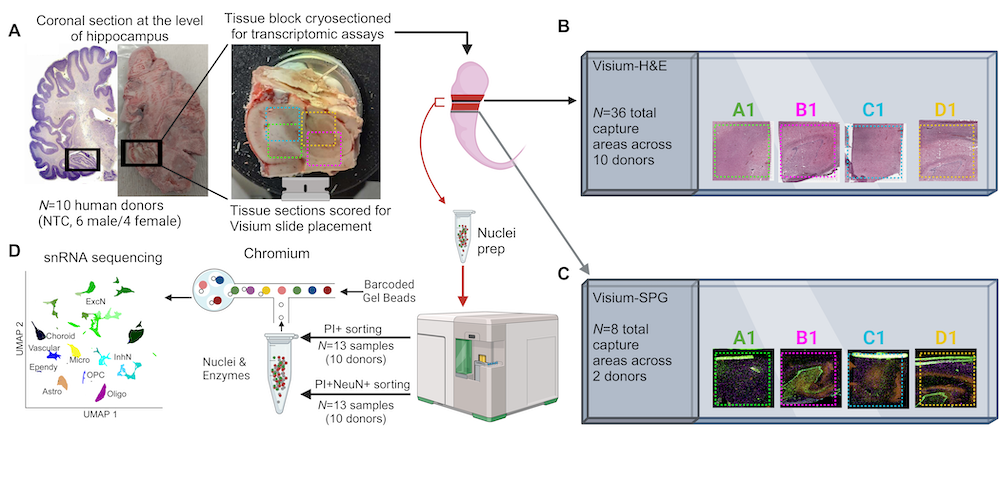

# Introduction to humanHippocampus2024

### Introduction

Welcome to the `humanHippocampus2024` package! In this vignettes, we are
going to show how to access the spatially-resolved transcriptomics (SRT)
and single-nucleus RNA-sequencing (snRNA-seq) data from adjacent tissue
sections of the anterior human hippocampus across ten adult neurotypical
donors generated by Lieber Institute for Brain Development (LIBD)
researchers and collaborators.

### Motivation

The main purpose to create R/Bioconductor package was to access the SRT
and snRNA-seq data from `spatial_HPC` project via an open-source and
public interface such that the data can be referenced or analyzed in
other projects conveniently.

### Study Design



Experimental design to generate paired single-nucleus RNA-sequencing
(snRNA-seq) and spatially-resolved transcriptomics (SRT) data in the
human hippocampus. (A) Postmortem human tissue blocks from the anterior
hippocampus were dissected from 10 adult neurotypical brain donors.
Tissue blocks were scored and cryosectioned for snRNA-seq assays (red),
and placement on Visium slides (Visium H&E, black; Visium Spatial
Proteogenomics (SPG), yellow). (B) 10$`\mu`$m tissue sections from all
ten donors were placed onto 2-5 capture areas to include the extent of
the HPC(n=36 total capture areas), for measurement with the 10x Genomics
Visium H&E platform. (C) 10$`\mu`$m tissue sections from two donors were
placed onto 4 capture areas (n=8 total capture areas) for measurement
with the 10x Genomics Visium-SPG platform. (D) Tissue sections (2-4
100$`\mu`$m cryosections per assay) from all ten donors were collected
from the same tissue blocks for measurement with the 10x Genomics 3’
gene expression platform. For each donor, we sorted on both and PI+NeuN+
(n=26 total snRNA-seq libraries). (This figure was created with
[Biorender](https://www.biorender.com/))

#### Data Access

All data, including raw FASTQ files and SpaceRanger/CellRanger processed
data outputs, can be accessed via Gene Expression Omnibus (GEO) under
accessions
[GSE264692](https://www.ncbi.nlm.nih.gov/geo/query/acc.cgi?acc=GSE264692)
(SRT) and
[GSE264624](https://www.ncbi.nlm.nih.gov/geo/query/acc.cgi?acc=GSE264624)
(snRNA-seq).

All R scripts created to perform analyses can be found
[here](https://github.com/LieberInstitute/spatial_hpc).

#### Contact

We value public questions, as they allow other users to learn from the
answers. If you have any questions, please ask them at
[LieberInstitute/spatial_hpc/issues](https://github.com/LieberInstitute/spatia%20l_hpc/issues)
and refrain from emailing us. Thank you again for your interest in our
work!

### Package Tutorial

#### Installation

`humanHippocampus2024` is an R package available via
[Bioconductor](http://bioconductor.org/) repository for packages. GitHub
repository can be found
[here](https://github.com/christinehou11/humanHippocampus2024).

Bioconductor version of 3.20 on R version of 4.4 is required.

``` r

if (!require("BiocManager", quietly = TRUE))
    install.packages("BiocManager")

BiocManager::install("humanHippocampus2024")

## Check that you have a valid Bioconductor installation
BiocManager::valid()
```

### *humanHippocampus2024* datasets

#### Load the packages

``` r

library(SummarizedExperiment)
library(SpatialExperiment)
library(humanHippocampus2024)
```

#### Download datasets

``` r

## Connect to ExperimentHub
library(ExperimentHub)
#> Loading required package: AnnotationHub
#> Loading required package: BiocFileCache
#> Loading required package: dbplyr
#> 
#> Attaching package: 'AnnotationHub'
#> The following object is masked from 'package:Biobase':
#> 
#>     cache
ehub <- ExperimentHub()

## Load the datasets of the package
myfiles <- query(ehub, "humanHippocampus2024")

## Resulting humanHippocampus2024 datasets from ExperimentHub query
myfiles
#> ExperimentHub with 2 records
#> # snapshotDate(): 2026-04-21
#> # $dataprovider: Lieber Institute for Brain Development (LIBD)
#> # $species: Homo sapiens
#> # $rdataclass: SpatialExperiment, SingleCellExperiment
#> # additional mcols(): taxonomyid, genome, description,
#> #   coordinate_1_based, maintainer, rdatadateadded, preparerclass, tags,
#> #   rdatapath, sourceurl, sourcetype 
#> # retrieve records with, e.g., 'object[["EH9605"]]' 
#> 
#>            title
#>   EH9605 | spe  
#>   EH9606 | sce
```

#### SRT dataset

SRT data in SpatialExperiment (spe) class was generated using 10x
Genomics Visium
(<https://www.10xgenomics.com/products/spatial-gene-expression>) (n=36
capture areas) and 10x Genomics Visium Spatial Proteogenomics (SPG)
(<https://www.10xgenomics.com/products/spatial-gene-and-protein-expression>)
(n=8 capture areas).

``` r

######################
#     spe data 
######################

# Downloading spatially-resolved transcriptomics data
# EH9605 | spe 
spatial_hpc_spe <- myfiles[["EH9605"]]
#> see ?humanHippocampus2024 and browseVignettes('humanHippocampus2024') for documentation
#> downloading 1 resources
#> retrieving 1 resource
#> loading from cache

# This is a SpatialExperiment object
spatial_hpc_spe
#> class: SpatialExperiment 
#> dim: 31483 150917 
#> metadata(1): Obtained_from
#> assays(2): counts logcounts
#> rownames(31483): MIR1302-2HG AL627309.1 ... AC007325.4 AC007325.2
#> rowData names(7): source type ... gene_type gene_search
#> colnames(150917): AAACAACGAATAGTTC-1_V10B01-086_D1
#>   AAACAAGTATCTCCCA-1_V10B01-086_D1 ... TTGTTTCCATACAACT-1_Br2720_B1
#>   TTGTTTGTATTACACG-1_Br2720_B1
#> colData names(150): sample_id in_tissue ... nmf99 nmf100
#> reducedDimNames(3): 10x_pca 10x_tsne 10x_umap
#> mainExpName: NULL
#> altExpNames(0):
#> spatialCoords names(2) : pxl_col_in_fullres pxl_row_in_fullres
#> imgData names(4): sample_id image_id data scaleFactor

# Check sample info
head(colData(spatial_hpc_spe), 3)
#> DataFrame with 3 rows and 150 columns
#>                                      sample_id in_tissue array_row array_col
#>                                       <factor> <logical> <numeric> <numeric>
#> AAACAACGAATAGTTC-1_V10B01-086_D1 V10B01-086_D1      TRUE       111         0
#> AAACAAGTATCTCCCA-1_V10B01-086_D1 V10B01-086_D1      TRUE        25        50
#> AAACAATCTACTAGCA-1_V10B01-086_D1 V10B01-086_D1      TRUE        84         3
#>                                  10x_graphclust 10x_kmeans_10_clusters
#>                                       <integer>              <integer>
#> AAACAACGAATAGTTC-1_V10B01-086_D1              2                      3
#> AAACAAGTATCTCCCA-1_V10B01-086_D1              1                      2
#> AAACAATCTACTAGCA-1_V10B01-086_D1              2                      3
#>                                  10x_kmeans_2_clusters 10x_kmeans_3_clusters
#>                                              <integer>             <integer>
#> AAACAACGAATAGTTC-1_V10B01-086_D1                     2                     2
#> AAACAAGTATCTCCCA-1_V10B01-086_D1                     1                     3
#> AAACAATCTACTAGCA-1_V10B01-086_D1                     2                     2
#>                                  10x_kmeans_4_clusters 10x_kmeans_5_clusters
#>                                              <integer>             <integer>
#> AAACAACGAATAGTTC-1_V10B01-086_D1                     2                     2
#> AAACAAGTATCTCCCA-1_V10B01-086_D1                     3                     3
#> AAACAATCTACTAGCA-1_V10B01-086_D1                     2                     2
#>                                  10x_kmeans_6_clusters 10x_kmeans_7_clusters
#>                                              <integer>             <integer>
#> AAACAACGAATAGTTC-1_V10B01-086_D1                     3                     3
#> AAACAAGTATCTCCCA-1_V10B01-086_D1                     2                     2
#> AAACAATCTACTAGCA-1_V10B01-086_D1                     3                     3
#>                                  10x_kmeans_8_clusters 10x_kmeans_9_clusters
#>                                              <integer>             <integer>
#> AAACAACGAATAGTTC-1_V10B01-086_D1                     2                     3
#> AAACAAGTATCTCCCA-1_V10B01-086_D1                     3                     2
#> AAACAATCTACTAGCA-1_V10B01-086_D1                     2                     3
#>                                                     key   sum_umi  sum_gene
#>                                             <character> <numeric> <integer>
#> AAACAACGAATAGTTC-1_V10B01-086_D1 AAACAACGAATAGTTC-1_V..      8159      3633
#> AAACAAGTATCTCCCA-1_V10B01-086_D1 AAACAAGTATCTCCCA-1_V..      1450       954
#> AAACAATCTACTAGCA-1_V10B01-086_D1 AAACAATCTACTAGCA-1_V..      5436      2622
#>                                  expr_chrM expr_chrM_ratio ManualAnnotation
#>                                  <numeric>       <numeric>      <character>
#> AAACAACGAATAGTTC-1_V10B01-086_D1       403       0.0493933               NA
#> AAACAAGTATCTCCCA-1_V10B01-086_D1       106       0.0731034               NA
#> AAACAATCTACTAGCA-1_V10B01-086_D1       555       0.1020971               NA
#>                                     brnum    dateImg experimenterImg      slide
#>                                  <factor>     <Date>        <factor>   <factor>
#> AAACAACGAATAGTTC-1_V10B01-086_D1   Br2743 2021-10-11  Stephanie Page V10B01-086
#> AAACAAGTATCTCCCA-1_V10B01-086_D1   Br2743 2021-10-11  Stephanie Page V10B01-086
#> AAACAATCTACTAGCA-1_V10B01-086_D1   Br2743 2021-10-11  Stephanie Page V10B01-086
#>                                     array position   seqNum experimenterSeq
#>                                  <factor> <factor> <factor>        <factor>
#> AAACAACGAATAGTTC-1_V10B01-086_D1       D1       TL   8v_scp  Stephanie Page
#> AAACAAGTATCTCCCA-1_V10B01-086_D1       D1       TL   8v_scp  Stephanie Page
#> AAACAATCTACTAGCA-1_V10B01-086_D1       D1       TL   8v_scp  Stephanie Page
#>                                           dx        race         sex       age
#>                                  <character> <character> <character> <numeric>
#> AAACAACGAATAGTTC-1_V10B01-086_D1     Control        CAUC           M     61.54
#> AAACAAGTATCTCCCA-1_V10B01-086_D1     Control        CAUC           M     61.54
#> AAACAATCTACTAGCA-1_V10B01-086_D1     Control        CAUC           M     61.54
#>                                        pmi       sum  detected subsets_Mito_sum
#>                                  <numeric> <numeric> <integer>        <numeric>
#> AAACAACGAATAGTTC-1_V10B01-086_D1      21.5      8159      3633              403
#> AAACAAGTATCTCCCA-1_V10B01-086_D1      21.5      1450       954              106
#> AAACAATCTACTAGCA-1_V10B01-086_D1      21.5      5436      2622              555
#>                                  subsets_Mito_detected subsets_Mito_percent
#>                                              <integer>            <numeric>
#> AAACAACGAATAGTTC-1_V10B01-086_D1                    12              4.93933
#> AAACAAGTATCTCCCA-1_V10B01-086_D1                    12              7.31034
#> AAACAATCTACTAGCA-1_V10B01-086_D1                    13             10.20971
#>                                      total low_sum_id low_sum_br
#>                                  <numeric>  <logical>  <logical>
#> AAACAACGAATAGTTC-1_V10B01-086_D1      8159      FALSE      FALSE
#> AAACAAGTATCTCCCA-1_V10B01-086_D1      1450      FALSE      FALSE
#> AAACAATCTACTAGCA-1_V10B01-086_D1      5436      FALSE      FALSE
#>                                  low_detected_id low_detected_br
#>                                        <logical>       <logical>
#> AAACAACGAATAGTTC-1_V10B01-086_D1           FALSE           FALSE
#> AAACAAGTATCTCCCA-1_V10B01-086_D1           FALSE           FALSE
#> AAACAATCTACTAGCA-1_V10B01-086_D1           FALSE           FALSE
#>                                  discard_auto_br discard_auto_id sizeFactor
#>                                        <logical>       <logical>  <numeric>
#> AAACAACGAATAGTTC-1_V10B01-086_D1           FALSE           FALSE   2.400629
#> AAACAAGTATCTCCCA-1_V10B01-086_D1           FALSE           FALSE   0.426635
#> AAACAATCTACTAGCA-1_V10B01-086_D1           FALSE           FALSE   1.599439
#>                                   cluster neuron_cell_body   domain
#>                                  <factor>        <logical> <factor>
#> AAACAACGAATAGTTC-1_V10B01-086_D1    CA1.1             TRUE     CA1 
#> AAACAAGTATCTCCCA-1_V10B01-086_D1    WM.2             FALSE     WM.2
#> AAACAATCTACTAGCA-1_V10B01-086_D1    CA1.1             TRUE     CA1 
#>                                  broad.domain      nmf1      nmf2      nmf3
#>                                      <factor> <numeric> <numeric> <numeric>
#> AAACAACGAATAGTTC-1_V10B01-086_D1       Neuron         0       NaN       NaN
#> AAACAAGTATCTCCCA-1_V10B01-086_D1       WM             0       NaN       NaN
#> AAACAATCTACTAGCA-1_V10B01-086_D1       Neuron         0       NaN       NaN
#>                                         nmf4      nmf5        nmf6        nmf7
#>                                    <numeric> <numeric>   <numeric>   <numeric>
#> AAACAACGAATAGTTC-1_V10B01-086_D1 2.27395e-05         0 3.28587e-05 2.95829e-06
#> AAACAAGTATCTCCCA-1_V10B01-086_D1 4.48045e-06         0 2.65465e-06 0.00000e+00
#> AAACAATCTACTAGCA-1_V10B01-086_D1 2.10045e-05         0 1.04418e-05 2.84576e-06
#>                                       nmf8      nmf9     nmf10     nmf11
#>                                  <numeric> <numeric> <numeric> <numeric>
#> AAACAACGAATAGTTC-1_V10B01-086_D1         0         0         0         0
#> AAACAAGTATCTCCCA-1_V10B01-086_D1         0         0         0         0
#> AAACAATCTACTAGCA-1_V10B01-086_D1         0         0         0         0
#>                                        nmf12       nmf13     nmf14       nmf15
#>                                    <numeric>   <numeric> <numeric>   <numeric>
#> AAACAACGAATAGTTC-1_V10B01-086_D1 1.22655e-05 3.52808e-05         0 1.08150e-04
#> AAACAAGTATCTCCCA-1_V10B01-086_D1 4.33318e-06 2.06538e-05         0 0.00000e+00
#> AAACAATCTACTAGCA-1_V10B01-086_D1 1.09472e-05 2.54767e-05         0 8.50595e-05
#>                                      nmf16     nmf17     nmf18     nmf19
#>                                  <numeric> <numeric> <numeric> <numeric>
#> AAACAACGAATAGTTC-1_V10B01-086_D1       NaN         0         0         0
#> AAACAAGTATCTCCCA-1_V10B01-086_D1       NaN         0         0         0
#> AAACAATCTACTAGCA-1_V10B01-086_D1       NaN         0         0         0
#>                                      nmf20     nmf21     nmf22     nmf23
#>                                  <numeric> <numeric> <numeric> <numeric>
#> AAACAACGAATAGTTC-1_V10B01-086_D1         0         0         0         0
#> AAACAAGTATCTCCCA-1_V10B01-086_D1         0         0         0         0
#> AAACAATCTACTAGCA-1_V10B01-086_D1         0         0         0         0
#>                                      nmf24     nmf25     nmf26     nmf27
#>                                  <numeric> <numeric> <numeric> <numeric>
#> AAACAACGAATAGTTC-1_V10B01-086_D1         0         0         0         0
#> AAACAAGTATCTCCCA-1_V10B01-086_D1         0         0         0         0
#> AAACAATCTACTAGCA-1_V10B01-086_D1         0         0         0         0
#>                                      nmf28     nmf29     nmf30     nmf31
#>                                  <numeric> <numeric> <numeric> <numeric>
#> AAACAACGAATAGTTC-1_V10B01-086_D1         0         0         0         0
#> AAACAAGTATCTCCCA-1_V10B01-086_D1         0         0         0         0
#> AAACAATCTACTAGCA-1_V10B01-086_D1         0         0         0         0
#>                                       nmf32     nmf33     nmf34     nmf35
#>                                   <numeric> <numeric> <numeric> <numeric>
#> AAACAACGAATAGTTC-1_V10B01-086_D1 0.00022619         0         0         0
#> AAACAAGTATCTCCCA-1_V10B01-086_D1 0.00000000         0         0         0
#> AAACAATCTACTAGCA-1_V10B01-086_D1 0.00000000         0         0         0
#>                                      nmf36     nmf37     nmf38     nmf39
#>                                  <numeric> <numeric> <numeric> <numeric>
#> AAACAACGAATAGTTC-1_V10B01-086_D1         0         0         0         0
#> AAACAAGTATCTCCCA-1_V10B01-086_D1         0         0         0         0
#> AAACAATCTACTAGCA-1_V10B01-086_D1         0         0         0         0
#>                                      nmf40     nmf41       nmf42     nmf43
#>                                  <numeric> <numeric>   <numeric> <numeric>
#> AAACAACGAATAGTTC-1_V10B01-086_D1         0         0 0.00000e+00         0
#> AAACAAGTATCTCCCA-1_V10B01-086_D1         0         0 2.69158e-05         0
#> AAACAATCTACTAGCA-1_V10B01-086_D1         0         0 0.00000e+00         0
#>                                        nmf44     nmf45     nmf46     nmf47
#>                                    <numeric> <numeric> <numeric> <numeric>
#> AAACAACGAATAGTTC-1_V10B01-086_D1 0.00000e+00         0         0         0
#> AAACAAGTATCTCCCA-1_V10B01-086_D1 2.97623e-05         0         0         0
#> AAACAATCTACTAGCA-1_V10B01-086_D1 0.00000e+00         0         0         0
#>                                        nmf48     nmf49     nmf50     nmf51
#>                                    <numeric> <numeric> <numeric> <numeric>
#> AAACAACGAATAGTTC-1_V10B01-086_D1 6.80418e-06         0         0         0
#> AAACAAGTATCTCCCA-1_V10B01-086_D1 4.99429e-06         0         0         0
#> AAACAATCTACTAGCA-1_V10B01-086_D1 5.75757e-06         0         0         0
#>                                      nmf52     nmf53     nmf54       nmf55
#>                                  <numeric> <numeric> <numeric>   <numeric>
#> AAACAACGAATAGTTC-1_V10B01-086_D1         0         0         0 3.64089e-06
#> AAACAAGTATCTCCCA-1_V10B01-086_D1         0         0         0 8.29104e-06
#> AAACAATCTACTAGCA-1_V10B01-086_D1         0         0         0 4.22433e-06
#>                                      nmf56     nmf57     nmf58      nmf59
#>                                  <numeric> <numeric> <numeric>  <numeric>
#> AAACAACGAATAGTTC-1_V10B01-086_D1         0         0         0 0.00000000
#> AAACAAGTATCTCCCA-1_V10B01-086_D1         0         0         0 0.00018553
#> AAACAATCTACTAGCA-1_V10B01-086_D1         0         0         0 0.00000000
#>                                      nmf60       nmf61     nmf62     nmf63
#>                                  <numeric>   <numeric> <numeric> <numeric>
#> AAACAACGAATAGTTC-1_V10B01-086_D1         0 1.74826e-05         0         0
#> AAACAAGTATCTCCCA-1_V10B01-086_D1         0 5.27230e-06         0         0
#> AAACAATCTACTAGCA-1_V10B01-086_D1         0 1.64522e-05         0         0
#>                                      nmf64     nmf65     nmf66     nmf67
#>                                  <numeric> <numeric> <numeric> <numeric>
#> AAACAACGAATAGTTC-1_V10B01-086_D1         0         0         0         0
#> AAACAAGTATCTCCCA-1_V10B01-086_D1         0         0         0         0
#> AAACAATCTACTAGCA-1_V10B01-086_D1         0         0         0         0
#>                                      nmf68     nmf69     nmf70     nmf71
#>                                  <numeric> <numeric> <numeric> <numeric>
#> AAACAACGAATAGTTC-1_V10B01-086_D1         0         0         0         0
#> AAACAAGTATCTCCCA-1_V10B01-086_D1         0         0         0         0
#> AAACAATCTACTAGCA-1_V10B01-086_D1         0         0         0         0
#>                                      nmf72     nmf73     nmf74       nmf75
#>                                  <numeric> <numeric> <numeric>   <numeric>
#> AAACAACGAATAGTTC-1_V10B01-086_D1         0         0         0 1.03960e-05
#> AAACAAGTATCTCCCA-1_V10B01-086_D1         0         0         0 6.35775e-06
#> AAACAATCTACTAGCA-1_V10B01-086_D1         0         0         0 1.08303e-05
#>                                      nmf76       nmf77     nmf78     nmf79
#>                                  <numeric>   <numeric> <numeric> <numeric>
#> AAACAACGAATAGTTC-1_V10B01-086_D1         0 4.89863e-07         0         0
#> AAACAAGTATCTCCCA-1_V10B01-086_D1         0 1.52269e-05         0         0
#> AAACAATCTACTAGCA-1_V10B01-086_D1         0 1.49846e-06         0         0
#>                                        nmf80       nmf81     nmf82     nmf83
#>                                    <numeric>   <numeric> <numeric> <numeric>
#> AAACAACGAATAGTTC-1_V10B01-086_D1 2.18171e-05 9.56545e-07         0         0
#> AAACAAGTATCTCCCA-1_V10B01-086_D1 0.00000e+00 2.03628e-06         0         0
#> AAACAATCTACTAGCA-1_V10B01-086_D1 1.72909e-04 3.13879e-06         0         0
#>                                      nmf84     nmf85     nmf86     nmf87
#>                                  <numeric> <numeric> <numeric> <numeric>
#> AAACAACGAATAGTTC-1_V10B01-086_D1         0         0         0         0
#> AAACAAGTATCTCCCA-1_V10B01-086_D1         0         0         0         0
#> AAACAATCTACTAGCA-1_V10B01-086_D1         0         0         0         0
#>                                      nmf88       nmf89     nmf90     nmf91
#>                                  <numeric>   <numeric> <numeric> <numeric>
#> AAACAACGAATAGTTC-1_V10B01-086_D1         0 1.39632e-06         0         0
#> AAACAAGTATCTCCCA-1_V10B01-086_D1         0 1.97323e-06         0         0
#> AAACAATCTACTAGCA-1_V10B01-086_D1         0 3.43709e-06         0         0
#>                                        nmf92     nmf93       nmf94     nmf95
#>                                    <numeric> <numeric>   <numeric> <numeric>
#> AAACAACGAATAGTTC-1_V10B01-086_D1 4.08908e-06         0 0.00000e+00         0
#> AAACAAGTATCTCCCA-1_V10B01-086_D1 5.38153e-06         0 4.48891e-05         0
#> AAACAATCTACTAGCA-1_V10B01-086_D1 5.54567e-06         0 0.00000e+00         0
#>                                      nmf96     nmf97     nmf98     nmf99
#>                                  <numeric> <numeric> <numeric> <numeric>
#> AAACAACGAATAGTTC-1_V10B01-086_D1         0         0         0         0
#> AAACAAGTATCTCCCA-1_V10B01-086_D1         0         0         0         0
#> AAACAATCTACTAGCA-1_V10B01-086_D1         0         0         0         0
#>                                     nmf100
#>                                  <numeric>
#> AAACAACGAATAGTTC-1_V10B01-086_D1         0
#> AAACAAGTATCTCCCA-1_V10B01-086_D1         0
#> AAACAATCTACTAGCA-1_V10B01-086_D1         0

# Check gene info
head(rowData(spatial_hpc_spe), 3)
#> DataFrame with 3 rows and 7 columns
#>               source     type         gene_id gene_version   gene_name
#>             <factor> <factor>     <character>  <character> <character>
#> MIR1302-2HG   HAVANA     gene ENSG00000243485            5 MIR1302-2HG
#> AL627309.1    HAVANA     gene ENSG00000238009            6  AL627309.1
#> AL627309.3    HAVANA     gene ENSG00000239945            1  AL627309.3
#>               gene_type            gene_search
#>             <character>            <character>
#> MIR1302-2HG      lncRNA MIR1302-2HG; ENSG000..
#> AL627309.1       lncRNA AL627309.1; ENSG0000..
#> AL627309.3       lncRNA AL627309.3; ENSG0000..

# Access the original counts
assays(spatial_hpc_spe)$counts[1:3, 1:3]
#> 3 x 3 sparse Matrix of class "dgCMatrix"
#>             AAACAACGAATAGTTC-1_V10B01-086_D1 AAACAAGTATCTCCCA-1_V10B01-086_D1
#> MIR1302-2HG                                .                                .
#> AL627309.1                                 .                                .
#> AL627309.3                                 .                                .
#>             AAACAATCTACTAGCA-1_V10B01-086_D1
#> MIR1302-2HG                                .
#> AL627309.1                                 .
#> AL627309.3                                 .

# Access the log-normalized counts
assays(spatial_hpc_spe)$logcounts[1:3, 1:3]
#> 3 x 3 sparse Matrix of class "dgCMatrix"
#>             AAACAACGAATAGTTC-1_V10B01-086_D1 AAACAAGTATCTCCCA-1_V10B01-086_D1
#> MIR1302-2HG                                .                                .
#> AL627309.1                                 .                                .
#> AL627309.3                                 .                                .
#>             AAACAATCTACTAGCA-1_V10B01-086_D1
#> MIR1302-2HG                                .
#> AL627309.1                                 .
#> AL627309.3                                 .

# Access the reduced dimension methods
reducedDimNames(spatial_hpc_spe)
#> [1] "10x_pca"  "10x_tsne" "10x_umap"

# Access the spatial coordinates
spatialCoordsNames(spatial_hpc_spe)
#> [1] "pxl_col_in_fullres" "pxl_row_in_fullres"

rm(spatial_hpc_spe)
```

#### snRNA-seq dataset

snRNA-seq data in SingleCellExperiment (sce) class was generated using
10x Genomics Chromium
(<https://www.10xgenomics.com/products/single-cell-gene-expression>)
(n=26 total snRNA-seq libraries).

``` r

######################
#     sce data 
######################

# Downloading single-nucleus RNA sequencing data
# EH9606 | sce
spatial_hpc_snrna_seq <- myfiles[["EH9606"]]
#> see ?humanHippocampus2024 and browseVignettes('humanHippocampus2024') for documentation
#> downloading 1 resources
#> retrieving 1 resource
#> loading from cache

# This is a SingleCellExperiment object
spatial_hpc_snrna_seq
#> class: SingleCellExperiment 
#> dim: 36601 75411 
#> metadata(1): Obtained_from
#> assays(2): counts logcounts
#> rownames(36601): TTR MALAT1 ... AC133551.1 AC141272.1
#> rowData names(7): source type ... gene_type poisson_deviance
#> colnames(75411): 1_AAACCCACAACGATCT-1 1_AAACGAAAGGTGAGCT-1 ...
#>   26_TTTGTTGGTGATTGGG-1 26_TTTGTTGGTTCAAAGA-1
#> colData names(132): Sample Barcode ... sex pmi
#> reducedDimNames(3): PCA MNN UMAP
#> mainExpName: NULL
#> altExpNames(0):

# Check sample info
head(colData(spatial_hpc_snrna_seq),3)
#> DataFrame with 3 rows and 132 columns
#>                        Sample            Barcode                 key       sum
#>                      <factor>        <character>         <character> <numeric>
#> 1_AAACCCACAACGATCT-1   1c-scp AAACCCACAACGATCT-1 AAACCCACAACGATCT-1_      1583
#> 1_AAACGAAAGGTGAGCT-1   1c-scp AAACGAAAGGTGAGCT-1 AAACGAAAGGTGAGCT-1_      3939
#> 1_AAACGAACACAAAGTA-1   1c-scp AAACGAACACAAAGTA-1 AAACGAACACAAAGTA-1_      2398
#>                       detected subsets_Mito_sum subsets_Mito_detected
#>                      <integer>        <numeric>             <integer>
#> 1_AAACCCACAACGATCT-1      1062               16                     9
#> 1_AAACGAAAGGTGAGCT-1      2133                7                     6
#> 1_AAACGAACACAAAGTA-1      1401               14                     7
#>                      subsets_Mito_percent     total high_mito   low_lib
#>                                 <numeric> <numeric> <logical> <logical>
#> 1_AAACCCACAACGATCT-1              1.01074      1583     FALSE     FALSE
#> 1_AAACGAAAGGTGAGCT-1              0.17771      3939     FALSE     FALSE
#> 1_AAACGAACACAAAGTA-1              0.58382      2398     FALSE     FALSE
#>                      low_genes discard_auto discard_semiauto doubletScore
#>                      <logical>    <logical>        <logical>    <numeric>
#> 1_AAACCCACAACGATCT-1     FALSE        FALSE            FALSE     0.066584
#> 1_AAACGAAAGGTGAGCT-1     FALSE        FALSE            FALSE     0.076096
#> 1_AAACGAACACAAAGTA-1     FALSE        FALSE            FALSE     0.009512
#>                        discard    brnum    round     sort sizeFactor logDoublet
#>                      <logical> <factor> <factor> <factor>  <numeric>  <numeric>
#> 1_AAACCCACAACGATCT-1     FALSE   Br8325        0       PI  0.0685330   -3.90868
#> 1_AAACGAAAGGTGAGCT-1     FALSE   Br8325        0       PI  0.2037986   -3.71604
#> 1_AAACGAACACAAAGTA-1     FALSE   Br8325        0       PI  0.0976826   -6.71604
#>                      k_5_louvain_initial k_5_louvain  discard2    cell.type2
#>                                 <factor>    <factor> <logical>      <factor>
#> 1_AAACCCACAACGATCT-1                   1           1     FALSE Oligo        
#> 1_AAACGAAAGGTGAGCT-1                   2           2     FALSE Micro/Macro/T
#> 1_AAACGAACACAAAGTA-1                   1           1     FALSE Oligo        
#>                             nmf1        nmf2        nmf3        nmf4      nmf5
#>                        <numeric>   <numeric>   <numeric>   <numeric> <numeric>
#> 1_AAACCCACAACGATCT-1 0.00000e+00 0.00000e+00 1.89191e-06 0.00000e+00         0
#> 1_AAACGAAAGGTGAGCT-1 1.21532e-05 0.00000e+00 2.29324e-05 0.00000e+00         0
#> 1_AAACGAACACAAAGTA-1 0.00000e+00 5.00542e-07 2.31828e-06 4.34041e-06         0
#>                           nmf6        nmf7      nmf8        nmf9     nmf10
#>                      <numeric>   <numeric> <numeric>   <numeric> <numeric>
#> 1_AAACCCACAACGATCT-1         0 0.00000e+00         0 5.29354e-06         0
#> 1_AAACGAAAGGTGAGCT-1         0 0.00000e+00         0 3.47221e-06         0
#> 1_AAACGAACACAAAGTA-1         0 2.17797e-06         0 2.49583e-05         0
#>                          nmf11       nmf12       nmf13     nmf14     nmf15
#>                      <numeric>   <numeric>   <numeric> <numeric> <numeric>
#> 1_AAACCCACAACGATCT-1         0 0.00000e+00 1.54408e-06         0         0
#> 1_AAACGAAAGGTGAGCT-1         0 1.00794e-06 0.00000e+00         0         0
#> 1_AAACGAACACAAAGTA-1         0 0.00000e+00 0.00000e+00         0         0
#>                          nmf16     nmf17     nmf18     nmf19     nmf20
#>                      <numeric> <numeric> <numeric> <numeric> <numeric>
#> 1_AAACCCACAACGATCT-1         0         0         0         0         0
#> 1_AAACGAAAGGTGAGCT-1         0         0         0         0         0
#> 1_AAACGAACACAAAGTA-1         0         0         0         0         0
#>                          nmf21     nmf22     nmf23       nmf24       nmf25
#>                      <numeric> <numeric> <numeric>   <numeric>   <numeric>
#> 1_AAACCCACAACGATCT-1         0         0         0 4.29416e-05 0.00000e+00
#> 1_AAACGAAAGGTGAGCT-1         0         0         0 0.00000e+00 2.44844e-06
#> 1_AAACGAACACAAAGTA-1         0         0         0 1.62841e-05 6.50203e-06
#>                          nmf26     nmf27       nmf28     nmf29     nmf30
#>                      <numeric> <numeric>   <numeric> <numeric> <numeric>
#> 1_AAACCCACAACGATCT-1         0         0 0.00000e+00         0         0
#> 1_AAACGAAAGGTGAGCT-1         0         0 2.00962e-06         0         0
#> 1_AAACGAACACAAAGTA-1         0         0 0.00000e+00         0         0
#>                            nmf31     nmf32      nmf33       nmf34     nmf35
#>                        <numeric> <numeric>  <numeric>   <numeric> <numeric>
#> 1_AAACCCACAACGATCT-1 2.65198e-06         0 0.00000000 0.00000e+00         0
#> 1_AAACGAAAGGTGAGCT-1 0.00000e+00         0 0.00000000 0.00000e+00         0
#> 1_AAACGAACACAAAGTA-1 7.15550e-06         0 0.00012796 9.60702e-07         0
#>                            nmf36       nmf37       nmf38       nmf39     nmf40
#>                        <numeric>   <numeric>   <numeric>   <numeric> <numeric>
#> 1_AAACCCACAACGATCT-1 0.00000e+00 2.33231e-05 2.03929e-04 0.000000000         0
#> 1_AAACGAAAGGTGAGCT-1 8.18709e-06 2.76864e-05 0.00000e+00 0.000102191         0
#> 1_AAACGAACACAAAGTA-1 0.00000e+00 2.81777e-05 8.06468e-05 0.000000000         0
#>                          nmf41       nmf42     nmf43       nmf44     nmf45
#>                      <numeric>   <numeric> <numeric>   <numeric> <numeric>
#> 1_AAACCCACAACGATCT-1         0 1.02996e-04         0 0.000145559         0
#> 1_AAACGAAAGGTGAGCT-1         0 9.34782e-06         0 0.000000000         0
#> 1_AAACGAACACAAAGTA-1         0 0.00000e+00         0 0.000300507         0
#>                          nmf46     nmf47     nmf48       nmf49     nmf50
#>                      <numeric> <numeric> <numeric>   <numeric> <numeric>
#> 1_AAACCCACAACGATCT-1         0         0         0 0.00000e+00         0
#> 1_AAACGAAAGGTGAGCT-1         0         0         0 2.14158e-06         0
#> 1_AAACGAACACAAAGTA-1         0         0         0 3.97464e-06         0
#>                          nmf51     nmf52     nmf53     nmf54       nmf55
#>                      <numeric> <numeric> <numeric> <numeric>   <numeric>
#> 1_AAACCCACAACGATCT-1         0         0         0         0 8.10701e-06
#> 1_AAACGAAAGGTGAGCT-1         0         0         0         0 1.38251e-05
#> 1_AAACGAACACAAAGTA-1         0         0         0         0 0.00000e+00
#>                            nmf56       nmf57       nmf58       nmf59     nmf60
#>                        <numeric>   <numeric>   <numeric>   <numeric> <numeric>
#> 1_AAACCCACAACGATCT-1 1.30526e-05 7.35371e-06 0.00000e+00 9.78114e-08         0
#> 1_AAACGAAAGGTGAGCT-1 4.79797e-06 1.47243e-06 5.15497e-06 0.00000e+00         0
#> 1_AAACGAACACAAAGTA-1 1.80609e-05 1.03655e-05 1.57277e-06 0.00000e+00         0
#>                          nmf61     nmf62     nmf63     nmf64     nmf65
#>                      <numeric> <numeric> <numeric> <numeric> <numeric>
#> 1_AAACCCACAACGATCT-1         0         0         0         0         0
#> 1_AAACGAAAGGTGAGCT-1         0         0         0         0         0
#> 1_AAACGAACACAAAGTA-1         0         0         0         0         0
#>                            nmf66     nmf67     nmf68     nmf69     nmf70
#>                        <numeric> <numeric> <numeric> <numeric> <numeric>
#> 1_AAACCCACAACGATCT-1 0.00000e+00         0         0         0         0
#> 1_AAACGAAAGGTGAGCT-1 2.59003e-07         0         0         0         0
#> 1_AAACGAACACAAAGTA-1 0.00000e+00         0         0         0         0
#>                            nmf71       nmf72       nmf73     nmf74       nmf75
#>                        <numeric>   <numeric>   <numeric> <numeric>   <numeric>
#> 1_AAACCCACAACGATCT-1 1.29844e-05 4.28539e-06 0.00000e+00         0 3.74648e-05
#> 1_AAACGAAAGGTGAGCT-1 2.82051e-06 2.56282e-06 2.46759e-06         0 3.67568e-05
#> 1_AAACGAACACAAAGTA-1 2.46076e-06 7.01058e-06 5.40694e-07         0 2.11332e-05
#>                          nmf76       nmf77     nmf78     nmf79       nmf80
#>                      <numeric>   <numeric> <numeric> <numeric>   <numeric>
#> 1_AAACCCACAACGATCT-1         0 0.00000e+00         0         0 1.17572e-06
#> 1_AAACGAAAGGTGAGCT-1         0 1.70319e-05         0         0 1.35350e-06
#> 1_AAACGAACACAAAGTA-1         0 4.96790e-05         0         0 0.00000e+00
#>                          nmf81      nmf82     nmf83     nmf84       nmf85
#>                      <numeric>  <numeric> <numeric> <numeric>   <numeric>
#> 1_AAACCCACAACGATCT-1         0 0.0000e+00         0         0 1.51082e-06
#> 1_AAACGAAAGGTGAGCT-1         0 2.8178e-04         0         0 0.00000e+00
#> 1_AAACGAACACAAAGTA-1         0 8.0724e-06         0         0 0.00000e+00
#>                          nmf86     nmf87     nmf88       nmf89       nmf90
#>                      <numeric> <numeric> <numeric>   <numeric>   <numeric>
#> 1_AAACCCACAACGATCT-1         0         0         0 0.00000e+00 0.000000000
#> 1_AAACGAAAGGTGAGCT-1         0         0         0 7.13175e-07 0.000761411
#> 1_AAACGAACACAAAGTA-1         0         0         0 0.00000e+00 0.000000000
#>                          nmf91       nmf92     nmf93       nmf94     nmf95
#>                      <numeric>   <numeric> <numeric>   <numeric> <numeric>
#> 1_AAACCCACAACGATCT-1         0 3.27635e-05         0 2.96047e-05         0
#> 1_AAACGAAAGGTGAGCT-1         0 5.68209e-06         0 1.85584e-06         0
#> 1_AAACGAACACAAAGTA-1         0 1.71284e-05         0 3.50191e-05         0
#>                            nmf96     nmf97       nmf98      nmf99    nmf100
#>                        <numeric> <numeric>   <numeric>  <numeric> <numeric>
#> 1_AAACCCACAACGATCT-1 0.00000e+00         0 0.000000000 0.0000e+00         0
#> 1_AAACGAAAGGTGAGCT-1 7.60918e-05         0 0.000141359 5.4575e-06         0
#> 1_AAACGAACACAAAGTA-1 0.00000e+00         0 0.000000000 0.0000e+00         0
#>                      fine.cell.class mid.cell.class broad.cell.class
#>                             <factor>       <factor>         <factor>
#> 1_AAACCCACAACGATCT-1   Oligo          Oligo                    Oligo
#> 1_AAACGAAAGGTGAGCT-1   Micro/Macro/T  Micro/Macro/T            Micro
#> 1_AAACGAACACAAAGTA-1   Oligo          Oligo                    Oligo
#>                      superfine.cell.class       age         sex       pmi
#>                                  <factor> <numeric> <character> <numeric>
#> 1_AAACCCACAACGATCT-1              Oligo.1     57.62           F        29
#> 1_AAACGAAAGGTGAGCT-1              Micro.1     57.62           F        29
#> 1_AAACGAACACAAAGTA-1              Oligo.1     57.62           F        29

# Check gene info
head(rowData(spatial_hpc_snrna_seq), 3)
#> DataFrame with 3 rows and 7 columns
#>          source     type         gene_id gene_version   gene_name
#>        <factor> <factor>     <character>  <character> <character>
#> TTR      HAVANA     gene ENSG00000118271           10         TTR
#> MALAT1   HAVANA     gene ENSG00000251562            8      MALAT1
#> DPP10    HAVANA     gene ENSG00000175497           16       DPP10
#>             gene_type poisson_deviance
#>           <character>        <numeric>
#> TTR    protein_coding         15438503
#> MALAT1         lncRNA         10289034
#> DPP10  protein_coding          8757887

# Access the original counts
assays(spatial_hpc_snrna_seq)$counts[1:3, 1:3]
#> 3 x 3 sparse Matrix of class "dgCMatrix"
#>        1_AAACCCACAACGATCT-1 1_AAACGAAAGGTGAGCT-1 1_AAACGAACACAAAGTA-1
#> TTR                       1                    .                    2
#> MALAT1                   33                   83                   49
#> DPP10                     .                    .                    .

# Access the log-normalized counts
assays(spatial_hpc_snrna_seq)$logcounts[1:3, 1:3]
#> 3 x 3 sparse Matrix of class "dgCMatrix"
#>        1_AAACCCACAACGATCT-1 1_AAACGAAAGGTGAGCT-1 1_AAACGAACACAAAGTA-1
#> TTR                3.962689             .                    4.424551
#> MALAT1             8.914445             8.673362             8.973338
#> DPP10              .                    .                    .

# Access the reduced dimension methods
reducedDimNames(spatial_hpc_snrna_seq)
#> [1] "PCA"  "MNN"  "UMAP"
```

### Citation

``` r

citation("humanHippocampus2024")
#> To cite package 'humanHippocampus2024' in publications use:
#> 
#>   Hou C (2026). _Access to spatial HPC project data_.
#>   doi:10.18129/B9.bioc.humanHippocampus2024
#>   <https://doi.org/10.18129/B9.bioc.humanHippocampus2024>.
#>   https://github.com/christinehou11/humanHippocampus2024/humanHippocampus2024
#>   - R package version 1.5.2,
#>   <http://www.bioconductor.org/packages/humanHippocampus2024>.
#> 
#>   Thompson JR, Nelson ED, Tippani M, Ramnauth AD, Divecha HR, Miller
#>   RA, Eagles NJ, Pattie EA, Kwon SH, Bach SV, Kaipa UM, Yao J, Hou C,
#>   Kleinman JE, Collado-Torres L, Han S, Maynard KR, Hyde TM,
#>   Martinowich K, Page SC, Hicks SC (2026). "An integrated
#>   single-nucleus and spatial transcriptomics atlas reveals the
#>   molecular landscape of the human hippocampus." _bioRxiv_.
#>   doi:10.1101/2024.04.26.590643
#>   <https://doi.org/10.1101/2024.04.26.590643>.
#>   <https://www.biorxiv.org/content/10.1101/2024.04.26.590643v1>.
#> 
#> To see these entries in BibTeX format, use 'print(<citation>,
#> bibtex=TRUE)', 'toBibtex(.)', or set
#> 'options(citation.bibtex.max=999)'.
```

### Reproducibility

This package was developed using
*[biocthis](https://bioconductor.org/packages/3.23/biocthis)*

Date the vignette was generated.

    #> [1] "2026-11-23 02:07:41 UTC"

`R` session information

    #> ─ Session info ───────────────────────────────────────────────────────────────────────────────────────────────────────
    #>  setting  value
    #>  version  R version 4.6.2 (2026-10-29)
    #>  os       Ubuntu 26.04.1 LTS
    #>  system   x86_64, linux-gnu
    #>  ui       X11
    #>  language en
    #>  collate  C.UTF-8
    #>  ctype    C.UTF-8
    #>  tz       UTC
    #>  date     2026-11-23
    #>  pandoc   3.8.3 @ /opt/hostedtoolcache/pandoc/3.8.3/x64/ (via rmarkdown)
    #>  quarto   NA
    #> 
    #> ─ Packages ───────────────────────────────────────────────────────────────────────────────────────────────────────────
    #>  package              * version date (UTC) lib source
    #>  abind                  1.4-8   2024-09-12 [1] RSPM
    #>  AnnotationDbi          1.74.0  2026-04-28 [1] Bioconduc~
    #>  AnnotationHub        * 4.2.2   2026-07-02 [1] Bioconduc~
    #>  bibtex                 0.5.3   2026-09-22 [1] RSPM
    #>  Biobase              * 2.72.0  2026-04-28 [1] Bioconduc~
    #>  BiocFileCache        * 3.2.0   2026-04-28 [1] Bioconduc~
    #>  BiocGenerics         * 0.58.1  2026-05-14 [1] Bioconduc~
    #>  BiocManager            1.30.27 2025-11-14 [1] RSPM
    #>  BiocStyle            * 2.40.0  2026-04-28 [1] Bioconduc~
    #>  BiocVersion            3.23.1  2025-10-30 [1] Bioconduc~
    #>  Biostrings             2.80.2  2026-09-02 [1] Bioconduc~
    #>  bit                    4.6.0   2025-03-06 [1] RSPM
    #>  bit64                  4.8.6   2026-09-01 [1] RSPM
    #>  blob                   1.3.0   2026-01-14 [1] RSPM
    #>  bookdown               0.48    2026-08-28 [1] RSPM
    #>  bslib                  0.12.0  2026-08-04 [1] RSPM
    #>  cachem                 1.1.0   2024-05-16 [1] RSPM
    #>  cli                    3.6.6   2026-04-09 [1] RSPM
    #>  crayon                 1.5.3   2024-06-20 [1] RSPM
    #>  curl                   8.1.0   2026-10-14 [1] RSPM
    #>  DBI                    1.3.0   2026-02-25 [1] RSPM
    #>  dbplyr               * 2.6.0   2026-06-17 [1] RSPM
    #>  DelayedArray           0.38.2  2026-05-26 [1] Bioconduc~
    #>  desc                   1.4.3   2023-12-10 [1] RSPM
    #>  digest                 0.6.39  2025-11-19 [1] RSPM
    #>  dplyr                  1.2.1   2026-04-03 [1] RSPM
    #>  evaluate               1.0.5   2025-08-27 [1] RSPM
    #>  ExperimentHub        * 3.2.2   2026-08-19 [1] Bioconduc~
    #>  fastmap                1.2.0   2024-05-15 [1] RSPM
    #>  filelock               1.0.3   2023-12-11 [1] RSPM
    #>  fs                     2.1.0   2026-04-18 [1] RSPM
    #>  generics             * 0.1.4   2025-05-09 [1] RSPM
    #>  GenomicRanges        * 1.64.0  2026-04-28 [1] Bioconduc~
    #>  glue                   1.8.1   2026-04-17 [1] RSPM
    #>  htmltools              0.5.9   2025-12-04 [1] RSPM
    #>  httr                   1.4.9   2026-09-01 [1] RSPM
    #>  httr2                  1.3.0   2026-07-13 [1] RSPM
    #>  humanHippocampus2024 * 1.5.2   2026-11-23 [1] local
    #>  IRanges              * 2.46.0  2026-04-28 [1] Bioconduc~
    #>  jquerylib              0.1.4   2021-04-26 [1] RSPM
    #>  jsonlite               2.0.0   2025-03-27 [1] RSPM
    #>  KEGGREST               1.52.2  2026-06-18 [1] Bioconduc~
    #>  knitr                  1.52    2026-09-06 [1] RSPM
    #>  lattice                0.23-1  2026-08-12 [3] CRAN (R 4.6.2)
    #>  lifecycle              1.0.5   2026-01-08 [1] RSPM
    #>  lubridate              1.9.5   2026-02-04 [1] RSPM
    #>  magick                 2.9.1   2026-02-28 [1] RSPM
    #>  magrittr               2.0.5   2026-04-04 [1] RSPM
    #>  Matrix                 1.7-6   2026-07-25 [3] CRAN (R 4.6.2)
    #>  MatrixGenerics       * 1.24.0  2026-04-28 [1] Bioconduc~
    #>  matrixStats          * 1.5.0   2025-01-07 [1] RSPM
    #>  memoise                2.0.1   2021-11-26 [1] RSPM
    #>  otel                   0.3.0   2026-11-07 [1] RSPM
    #>  pillar                 1.11.1  2025-09-17 [1] RSPM
    #>  pkgconfig              2.0.3   2019-09-22 [1] RSPM
    #>  pkgdown                2.2.1   2026-07-07 [1] any (@2.2.1)
    #>  plyr                   1.8.9   2023-10-02 [1] RSPM
    #>  png                    0.1-9   2026-03-15 [1] RSPM
    #>  purrr                  1.2.2   2026-04-10 [1] RSPM
    #>  R6                     2.6.1   2025-02-15 [1] RSPM
    #>  ragg                   1.5.2   2026-03-23 [1] RSPM
    #>  rappdirs               0.3.4   2026-01-17 [1] RSPM
    #>  Rcpp                   1.1.2   2026-07-05 [1] RSPM
    #>  RefManageR           * 1.4.0   2022-09-30 [1] RSPM
    #>  rjson                  0.2.23  2024-09-16 [1] RSPM
    #>  rlang                  1.3.0   2026-07-05 [1] RSPM
    #>  rmarkdown              2.32    2026-09-01 [1] RSPM
    #>  RSQLite                3.53.3  2026-06-30 [1] RSPM
    #>  S4Arrays               1.12.1  2026-09-22 [1] Bioconduc~
    #>  S4Vectors            * 0.50.3  2026-09-16 [1] Bioconduc~
    #>  sass                   0.5.0   2026-11-20 [1] RSPM
    #>  Seqinfo              * 1.2.0   2026-04-28 [1] Bioconduc~
    #>  sessioninfo          * 1.2.4   2026-06-04 [1] RSPM
    #>  SingleCellExperiment * 1.34.0  2026-04-28 [1] Bioconduc~
    #>  SparseArray            1.12.3  2026-09-22 [1] Bioconduc~
    #>  SpatialExperiment    * 1.22.0  2026-04-28 [1] Bioconduc~
    #>  stringi                1.8.9   2026-08-04 [1] RSPM
    #>  stringr                1.6.0   2025-11-04 [1] RSPM
    #>  SummarizedExperiment * 1.42.0  2026-04-28 [1] Bioconduc~
    #>  systemfonts            1.3.4   2026-11-21 [1] RSPM
    #>  textshaping            1.1.0   2026-11-20 [1] RSPM
    #>  tibble                 3.3.1   2026-01-11 [1] RSPM
    #>  tidyselect             1.2.1   2024-03-11 [1] RSPM
    #>  timechange             0.4.0   2026-01-29 [1] RSPM
    #>  vctrs                  0.7.3   2026-04-11 [1] RSPM
    #>  withr                  3.0.3   2026-06-19 [1] RSPM
    #>  xfun                   0.62    2026-10-16 [1] RSPM
    #>  xml2                   1.6.0   2026-06-22 [1] RSPM
    #>  XVector                0.52.0  2026-04-28 [1] Bioconduc~
    #>  yaml                   2.3.12  2025-12-10 [1] RSPM
    #> 
    #>  [1] /home/runner/work/_temp/Library
    #>  [2] /opt/R/4.6.2/lib/R/site-library
    #>  [3] /opt/R/4.6.2/lib/R/library
    #>  * ── Packages attached to the search path.
    #> 
    #> ──────────────────────────────────────────────────────────────────────────────────────────────────────────────────────

### Bibliography

This vignette was generated using
*[BiocStyle](https://bioconductor.org/packages/3.23/BiocStyle)* (Oleś,
2026) with *[knitr](https://CRAN.R-project.org/package=knitr)* (Xie,
2026) and *[rmarkdown](https://CRAN.R-project.org/package=rmarkdown)*
(Allaire, Xie, Dervieux, McPherson, Luraschi, Ushey, Atkins, Wickham,
Cheng, Chang, and Iannone, 2026) running behind the scenes.

Citations made with
*[RefManageR](https://CRAN.R-project.org/package=RefManageR)* (McLean,
2017).

[\[1\]](#cite-allaire2026rmarkdown) J. Allaire, Y. Xie, C. Dervieux, et
al. *rmarkdown: Dynamic Documents for R*. R package version 2.32. 2026.
URL: <https://github.com/rstudio/rmarkdown>.

[\[2\]](#cite-mclean2017refmanager) M. W. McLean. “RefManageR: Import
and Manage BibTeX and BibLaTeX References in R”. In: *The Journal of
Open Source Software* (2017). DOI:
[10.21105/joss.00338](https://doi.org/10.21105/joss.00338).

[\[3\]](#cite-ole2026biocstyle) A. Oleś. *BiocStyle: Standard styles for
vignettes and other Bioconductor documents*. R package version 2.40.0.
2026. DOI:
[10.18129/B9.bioc.BiocStyle](https://doi.org/10.18129/B9.bioc.BiocStyle).
URL: <https://bioconductor.org/packages/BiocStyle>.

[\[4\]](#cite-xie2026knitr) Y. Xie. *knitr: A General-Purpose Package
for Dynamic Report Generation in R*. R package version 1.52. 2026. URL:
<https://yihui.org/knitr/>.
